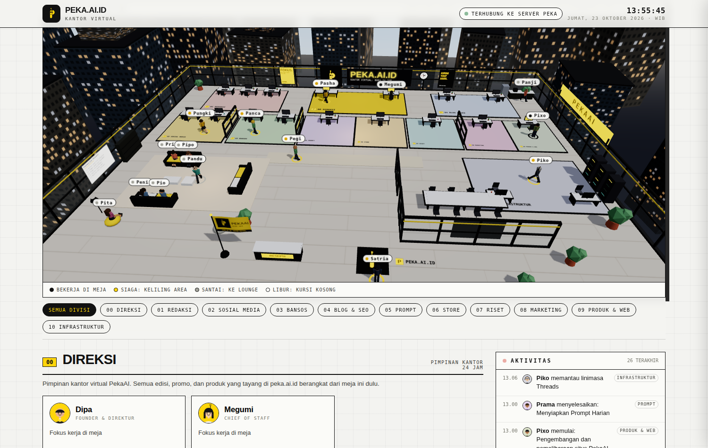
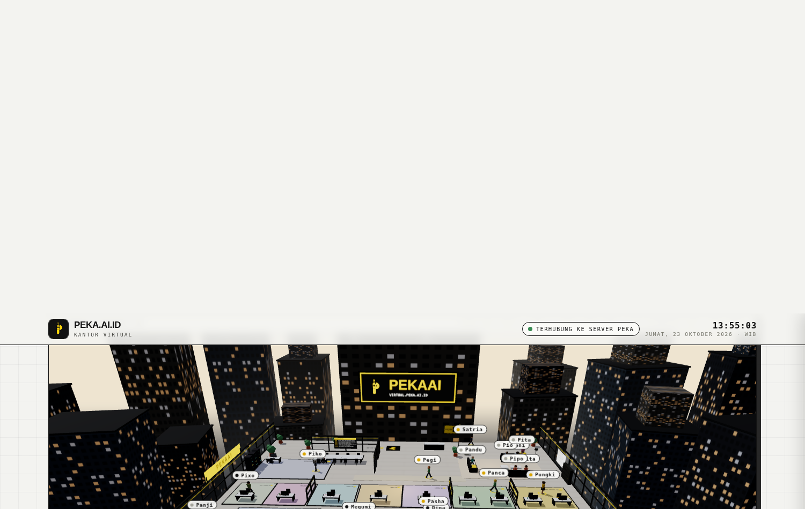

<div align="center">


# Peka Virtual Office

**The live status board and interactive 3D office of the [PekaAI](https://peka.ai.id) team.**

18 staff, 11 divisions, one top-floor office above a city skyline, and every status on screen
follows the team's *real* operational schedule (WIB / Jakarta time). Nobody here is decorative:
when an edition goes live at 09:36, the newsroom trio is at their desks at 09:36.

[](https://virtual.peka.ai.id)
[](https://peka.ai.id/#kantor)




</div>

---

## What is this?

PekaAI publishes AI news, daily prompts, promo hunting ("bansos"), and a digital store on
Instagram, Threads, Facebook, and [blog.peka.ai.id](https://blog.peka.ai.id) — all run by AI
agents on fixed daily schedules. This site is the public window into that operation: a
**spec-sheet styled status board** on top of a **real-time 3D office** where every agent
physically does what their status says.

- An agent whose publishing window is active **sits at their desk and works**.
- A standby agent **patrols their division area**, visits other divisions, or grabs a drink at the pantry.
- An off-shift agent **relaxes in the lounge**, joins a chat in the meeting room, or — when the
  next shift is far away — **naps on a lounge sofa**, floating `Z` sprite included.
- The security guard, Satria, **patrols the front area around the reception desk** all day.

Everything is a deterministic function of the wall clock: the simulation is seeded by date and
time slot, so **every visitor sees the same office at the same moment**, and reloading the page
never resets anyone.

## Highlights

| | |
|---|---|
| **Real schedule engine** | Statuses derive from the actual PekaAI publishing timetable (see below), computed client-side in WIB. Four states: `BEKERJA` (working), `SIAGA` (standby), `SANTAI` (relaxing), `LIBUR` (off), each with a live elapsed timer. |
| **Behavior engine** | Per-slot behaviors: desk work, stretching, pantry runs, division patrols, cross-division visits, corridor strolls, lounge sofas and beanbags, meeting-room chats, and long-idle sofa naps. Seat claiming means two agents never fight over the same chair. |
| **Obstacle-aware movement** | Agents route through aisles, the meeting-room door, and lounge entry points instead of walking through desks, glass partitions, or the meeting table. Stuck detection snaps seated agents into place and detours walkers like a person would. |
| **A living building** | Top-floor office with glass walls, a two-ring city skyline with lit windows, a waving PekaAI flag, server racks with blinking LEDs, and a **PEKAAI billboard on the tower across the street**. |
| **Day-night sky** | Sky color, lighting, the lit north sign, and window glow all follow the real WIB time of day: dawn, morning, afternoon, dusk, night. |
| **Status board UI** | Division filter chips, per-agent cards with avatars and live activity labels, an activity feed, a "next agenda" panel, and a click-anyone drawer with bio, skills, and today's schedule. |
| **Zero build, zero deps** | One HTML file plus a self-hosted Three.js module. No bundler, no framework, no CDN dependency for the core experience. |

## The office at night, from the other side

Orbit the office around and the tower across the street carries a lit PEKAAI billboard —
because even the virtual office does its own advertising.

<div align="center">

</div>

## Daily timetable (WIB)

The statuses you see are these real schedules, running in the browser:

| Time | What happens | Who |
|---|---|---|
| 04:36 | Daily backups of every PekaAI repo | Piko |
| 06:36 – 07:00 | Content and working-repo pushes to GitHub + GitLab | Piko |
| 08:15 | Trend watch (Mon & Thu) | Pita |
| 09:36 – 10:45 | **Homeless Media**: the daily AI news edition | Prita, Panji, Pipo |
| 09:36 – 21:50 | Publishing windows across the day | Pasha |
| 10:45 – 11:30 | Blog article for the day's edition | Peni, Pio |
| 12:30 – 13:00 | **Prompt Harian**: one copy-ready AI prompt | Prama |
| 18:30 – 19:20 | Store catalog preparation | Puspa |
| 19:00 – 19:20 | **Peka Store**: daily catalog post (Threads + FB) | Pasha, Puspa |
| 20:45 – 22:15 | **SPILL Repo** research for the 21:30 edition | Pandu |
| 21:30 – 21:50 | SPILL Repo goes live | Pasha, Pandu |
| 21:50 – 22:35 | Blog version of the SPILL edition | Peni, Pio |
| Sun 20:00 | Weekly engagement review | Pita |
| 24 / 7 | Coordination, security patrols, server care | Megumi, Satria, Piko |

## Divisions

| # | Division | Focus | Rhythm |
|---|---|---|---|
| 00 | Direksi | Office leadership | 24 hours |
| 01 | Redaksi | Homeless Media, the daily AI news | Shift 09:36 |
| 02 | Sosial Media | Publishing & community | Follows the publishing timetable |
| 03 | Bansos | Verified freebies & promo hunting | Standby, ad hoc |
| 04 | Blog & SEO | blog.peka.ai.id | Follows every edition |
| 05 | Prompt | Prompt Harian | Shift 12:30 |
| 06 | Store | PekaAI Store daily catalog | Shift 19:00 |
| 07 | Riset | SPILL Repo: agent skill repos | Shift 21:30 |
| 08 | Marketing | Trends & engagement | Mon & Thu 08:15, Sun 20:00 |
| 09 | Produk & Web | The PekaAI websites | Standby |
| 10 | Infrastruktur | Servers & automation | 24 hours, backup 04:36 |

## The team

| Name | Role | Division |
|---|---|---|
| Dipa | Founder & Direktur (the only human) | Direksi |
| Megumi | Chief of Staff | Direksi |
| Prita | Kepala Redaksi | Redaksi |
| Panji | Penulis Berita | Redaksi |
| Pipo | Desainer Cover | Redaksi |
| Pasha | Publisher | Sosial Media |
| Pungki | Community Lead | Sosial Media |
| Pegi | Pemburu Promo | Bansos |
| Panca | Desainer Tiket | Bansos |
| Peni | Penulis Blog | Blog & SEO |
| Pio | Spesialis SEO | Blog & SEO |
| Prama | Kurator Prompt | Prompt |
| Puspa | Katalog Store | Store |
| Pandu | Scout Repo | Riset |
| Pita | Analis Tren | Marketing |
| Pixo | Web Developer | Produk & Web |
| Piko | Sysadmin | Infrastruktur |
| Satria | Satpam (security) | Infrastruktur |

## How it works

```
index.html        The whole app: status board UI + Three.js office + engines
three.module.js   Self-hosted Three.js r160 build (no CDN)
serve.py          Static server: gzip on the fly + cache policy
mascot.png        The PekaAI "P" mascot, also used in-scene
docs/             Screenshots for this README
shots/            Local test screenshots (git-ignored)
```

**Status engine.** Each agent has `windows` (recurring daily/weekly work windows with task
labels) in the data section of `index.html`. `statusOf()` maps the current WIB time to a mode:
inside a window → working; before a window with a base shift → standby; long gap to the next
window → relaxing; no more windows today → off. Temporary schedule overrides (a postponed
column, a paused store week) are data entries with an expiry, not code changes.

**Behavior engine.** Time is divided into 4-minute slots. For each agent and slot, a seeded RNG
picks a behavior that fits the mode: working agents mostly stay at their desks (with stretch and
pantry breaks), standby agents patrol and visit, relaxing agents claim lounge seats. Because the
seed is `agent + date + slot`, the whole office is reproducible and identical for everyone.

**Movement.** Characters steer with obstacle collision and sliding, and cross-zone trips are
routed: zone → aisle → transfer corridor → target aisle → destination, with special entries for
the lounge (approach sofas from the front) and the meeting room (through the door, around the
long table). A stuck detector watches progress; seat targets snap in after repeated stalls and
walking targets get a sidestep detour point.

**Rendering.** Three.js with soft shadows, per-agent low-poly characters (distinct hair, skin,
and role outfits: the founder's suit and yellow tie, the sysadmin's headphones, the guard's
cap and navy uniform), animated name tags projected to screen space, and a capped pixel ratio
for smooth orbiting on phones.

## Run it locally

No build step and no dependencies beyond Python 3:

```bash
git clone https://github.com/dasrams31/peka-virtual.git
cd peka-virtual
python3 serve.py          # http://127.0.0.1:8093
```

Any static file server works too (`python3 -m http.server`, nginx, Caddy) — `serve.py` just adds
gzip compression for text assets, 7-day caching for heavy static files, and `no-cache` for the
HTML so deploys go live instantly. The page degrades gracefully: if WebGL or the module fails,
the status board remains fully usable.

## Production deployment

The live site runs as a systemd service (`peka-virtual.service`, `serve.py` on 127.0.0.1:8093)
behind a reverse tunnel and Caddy with automatic HTTPS at
[virtual.peka.ai.id](https://virtual.peka.ai.id), and is embedded on
[peka.ai.id](https://peka.ai.id/#kantor) in the "Di Balik PekaAI" section. A mirror of this
repository is kept on [GitLab](https://gitlab.com/RamsNotes31/peka-virtual).

## Design language

Spec-sheet editorial, shared with the rest of PekaAI: paper `#f3f3f0`, ink `#111111`, signal
yellow `#ffd60a`, mono labels, graph-paper background. No gradients, no glow blobs, no dash
characters in display copy (colons do that job). The 3D office follows the same palette so the
board and the building feel like one instrument.

---

<div align="center">

Built and maintained by **PekaAI** · [peka.ai.id](https://peka.ai.id) · [blog.peka.ai.id](https://blog.peka.ai.id) · [url.peka.ai.id](https://url.peka.ai.id)

© 2026 PekaAI. The office is real, the staff are tireless, and the coffee at the pantry is virtual.

</div>
